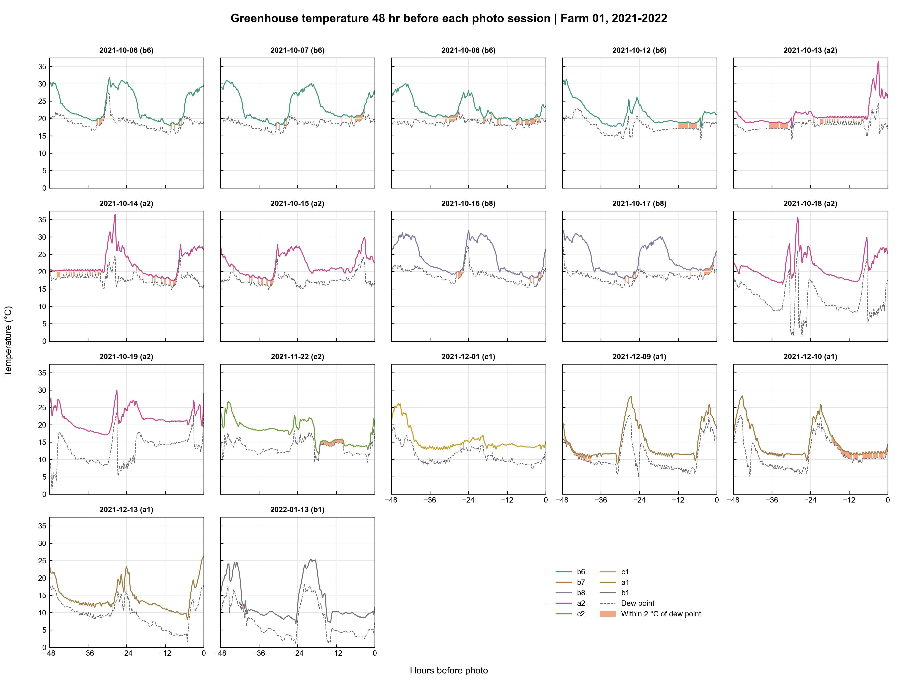

# Greenhouse Temperature Before Photo Sessions

A Python data visualisation project that compares greenhouse air temperature and dew point across the 48-hour windows displayed before plant photo sessions. The included example uses strawberry validation data from **Farm 01**, with **7,891 unique photos across 17 dates**, from **6 October 2021 to 13 January 2022**.

The analysis connects plant photographs with their environmental context and highlights readings where air temperature is less than 2°C above the dew point.

## Greenhouse temperature figure



[Open the full-size figure](figures/f4_photo_sessions.png)

Each panel represents a photo-session date. The solid line shows air temperature, the dashed grey line shows dew point, and the orange shading marks readings where `temperature − dew point < 2°C`. All panels share the same temperature scale. The horizontal axis runs from −48 to 0 hours, with zero set to the latest selected sensor reading for that date.

> **Timing issue identified during verification:** the panels labelled **16 and 17 October 2021** use sensor histories ending on **6 and 7 October**, respectively. These two panels are preserved from the supplied figure but should not be interpreted as verified conditions immediately before the labelled photo dates. The result table flags both mismatches. See [methods and data checks](docs/METHODS.md).

## Summary

The displayed records show repeated warming and cooling cycles, lower temperature baselines in the later sampled dates, and substantial variation in how closely air temperature approaches the dew point. The near-dew-point pattern is not explained by temperature alone: some cool periods have little shading, while other sessions contain many readings close to the dew point.

This is a descriptive environmental analysis. It helps identify sessions worth investigating and exposes limitations in matching photos to sensor histories. It does not establish that temperature or humidity caused the labelled plant conditions.

## What can be found from the data?

The following values were recalculated from the source sensor files using the notebook's selection rules and only the visible −48-to-0-hour windows. They are not estimates read from the image.

### Temperature patterns

- **The highest displayed temperature was 36.5°C**, appearing in the overlapping windows labelled 13 and 14 October. A peak repeated in neighbouring panels can be the same event rather than two independent events.
- **Later sampled sessions had lower temperature baselines.** The 6 October window averaged **23.7°C**, compared with **13.1°C** for 13 January. Their ranges were **17.9–31.8°C** and **6.9–25.4°C**, respectively. These are selected session windows, not monthly means or a continuous seasonal record.
- **Short peaks and broader cycles both occur.** The 18 October window reached **35.6°C** but also contained sharp changes in dew point. Sensor quality and greenhouse operating records would be needed to explain those changes.

### Near-dew-point conditions

- **10 December had the largest share of readings below the 2°C gap threshold:** **95 of 289 readings (32.9%)**.
- The 13 and 14 October windows also had relatively high shares: **30.1%** and **29.8%**, respectively. These windows overlap, so their percentages should not be combined as independent exposure estimates.
- **18 and 19 October had no readings below the threshold**, despite their temperature fluctuations. A high temperature peak alone does not determine proximity to the dew point.
- The 13 January window had **4 of 288 readings (1.4%)** below the threshold. Cooler air in this window did not automatically mean a small dew-point gap.

| Photo-session date | Panel code | Temperature range (°C) | Mean (°C) | Readings with gap <2°C |
| --- | --- | ---: | ---: | ---: |
| 2021-10-06 | b6* | 17.9–31.8 | 23.7 | 33/289 (11.4%) |
| 2021-10-13 | a2 | 17.4–36.5 | 21.2 | 87/289 (30.1%) |
| 2021-10-14 | a2 | 17.4–36.5 | 22.1 | 86/289 (29.8%) |
| 2021-10-18 | a2 | 16.4–35.6 | 21.2 | 0/289 (0.0%) |
| 2021-12-10 | a1 | 9.7–28.3 | 15.0 | 95/289 (32.9%) |
| 2022-01-13 | b1 | 6.9–25.4 | 13.1 | 4/288 (1.4%) |

*The 6 October date contains b6, b7 and b8 photos; b6 is the first code used for its panel title. The same applies to 7, 8 and 12 October. Codes are retained as dataset identifiers because an authoritative code-to-condition mapping was not supplied.*

[View all 17 session results](results/session_summary.csv), including the actual sensor endpoints and date-mismatch flags. Percentages describe sampled readings, not exact hours of exposure. All visible readings are spaced 10 minutes apart; some windows contain 288 points and others 289 because of endpoint coverage.

## What are the implications?

1. **Monitor temperature together with moisture conditions.** A small air-temperature/dew-point gap identifies periods worth checking for condensation risk. Actual leaf condensation depends on leaf-surface temperature, which is not measured here. [UMass Extension](https://www.umass.edu/agriculture-food-environment/greenhouse-floriculture/fact-sheets/reducing-humidity-in-greenhouse) explains this relationship and the role of greenhouse humidity management.
2. **Use the figure to prioritise inspection.** Sessions with many near-dew-point readings, such as 10 December, are candidates for reviewing leaf wetness, ventilation, irrigation timing and environmental-control records. This figure alone does not determine an operating setpoint or demonstrate that an intervention would improve plant health.
3. **Verify time matching before drawing biological conclusions.** The ten-day mismatches show why linking files by name is insufficient. Full photo timestamps and sensor coverage should be checked before calculating conditions before each photo.
4. **Account for farm, date and growth stage in future modelling.** Farm 01 contains the non-healthy condition codes, while healthy code `00` appears in other farms. Within Farm 01, a1 photos all have growth code 13; the other conditions have growth code 12. Randomly splitting photos could therefore allow a model to learn farm, season or repeated sensor histories instead of condition-specific information. Evaluate grouped splits that keep overlapping environmental windows together and assess whether the available classes support the intended comparison.

## Dataset coverage

The source notebook initially counted 26,866 label entries because archive and extracted copies were both present. Deduplicating filename stems gives **13,433 unique labels** across four farms. Farm 01 was selected because it has the most photo dates.

| Condition code | Farm 01 photos | Photo dates | First–last photo date |
| --- | ---: | ---: | --- |
| b6 | 928 | 4 | 2021-10-06–2021-10-12 |
| b7 | 1,048 | 4 | 2021-10-06–2021-10-12 |
| b8 | 1,019 | 6 | 2021-10-06–2021-10-17 |
| a2 | 1,227 | 5 | 2021-10-13–2021-10-19 |
| c2 | 659 | 1 | 2021-11-22 |
| c1 | 721 | 1 | 2021-12-01 |
| a1 | 1,787 | 3 | 2021-12-09–2021-12-13 |
| b1 | 502 | 1 | 2022-01-13 |

Photo counts total 7,891. Date counts overlap across codes and must not be summed to obtain the number of sessions. A condition code labels photographed plants; it does not identify a separate greenhouse treatment.

## Repository files

| File | Purpose |
| --- | --- |
| [`multi_figure_graph.py`](multi_figure_graph.py) | Portable command-line version; generates figures and CSV summaries. |
| [`multi_figure_graph.ipynb`](multi_figure_graph.ipynb) | Supplied notebook with portable data paths and its stored results. |
| [`figures/f4_photo_sessions.png`](figures/f4_photo_sessions.png) | Original supplied figure, preserved without alteration. |
| [`results/session_summary.csv`](results/session_summary.csv) | Statistics for all 17 displayed windows and timing checks. |
| [`results/condition_summary.csv`](results/condition_summary.csv) | Photo counts and date coverage by condition code. |
| [`results/farm_summary.csv`](results/farm_summary.csv) | Unique-photo and date counts by anonymous farm. |
| [`docs/METHODS.md`](docs/METHODS.md) | Selection rules, time origin, thresholds and interpretation limits. |
| [`requirements.txt`](requirements.txt) | Dependency versions used for verification. |

## Run locally

Tested with Python 3.13.9, pandas 2.3.3, NumPy 2.3.5 and Matplotlib 3.10.6.

1. Download or clone this repository and open its folder.
2. Create a virtual environment and install dependencies:

   ```bash
   python -m venv .venv
   ```

   Activate it with `.\.venv\Scripts\Activate.ps1` in Windows PowerShell, or `source .venv/bin/activate` on macOS/Linux. Then run:

   ```bash
   python -m pip install -r requirements.txt
   ```

3. Keep the source validation data outside the published repository, or use this ignored local layout:

   ```text
   data/2.Validation/
   ├── 라벨링데이터/     # JSON labels, loose or in ZIP files
   └── 환경센서/         # CP949 sensor CSVs, loose or in ZIP files
   ```

4. Generate the figures and summaries:

   ```bash
   python multi_figure_graph.py --data-dir "data/2.Validation" --out "outputs"
   ```

   Replace the data path with your existing validation folder if needed. The script writes `f4_photo_sessions.png`, 17 individual plots in `sessions/`, and three summary CSVs. It warns when a sensor endpoint does not fall on its labelled photo date. Rerunning replaces files with the same names inside the chosen output folder.

For notebook use, install JupyterLab separately (`python -m pip install jupyterlab`), start `jupyter lab` from the repository folder, and open `multi_figure_graph.ipynb`. Use the local layout above or set `GREENHOUSE_DATA_DIR` before starting Jupyter. Run the cells in order. The notebook preserves the original workflow; the standalone script adds summary exports and date warnings.

## Data and reuse

The inputs are the strawberry archives in the local validation dataset named `104.식물 병 유발 통합 데이터`. 
